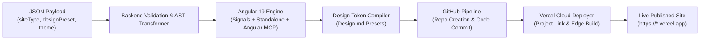

# SiteForge Technical Architecture

## 1. Executive Summary & Vision
**SiteForge** (The Autonomous Angular Web Factory) is an end-to-end autonomous manufacturing platform for web applications. Taking a structured JSON payload as input, SiteForge orchestrates code generation, template compilation, styling application, GitHub repository creation, and zero-configuration production deployment to Vercel.



---

## 2. Commercial Name Selection
To maximize commercial appeal, memorability, and developer resonance:
* **Primary Selected Name: SiteForge** (Tagline: *The Autonomous Angular Web Factory*)
* **Alternative Candidates Evaluated**:
  * **VeloSite Engine**: Highlighting speed and instant generation.
  * **StructaWeb / Structura**: Emphasizing schema-driven structural integrity.
  * **OmniSite Factory**: Emphasizing multi-archetype versatility.

---

## 3. Core Architecture Pillars

### 3.1 Pillar 1: Archetype & Type of Website (`siteType`)
SiteForge treats website structures as parameterized archetypes with pre-engineered component sets:
* `learning_platform`: Courses, modules, lessons, instructors, quizzes, student progress, difficulty tags.
* `blog`: Categorized articles, reading time estimators, author bio, newsletter callouts, markdown rendering.
* `newsletter`: Issue archive, curation highlights, subscriber capture forms, sponsorship badges.
* `ecommerce`: Product catalogs, filtering, cart preview, pricing tiers, feature comparison tables.
* `social_media` / `community`: Discussion feeds, author profiles, topic tags, comment threads, upvotes.
* `landing_page`: High-conversion hero banners, feature grids, proof points, testimonial carousels, CTA buttons.

### 3.2 Pillar 2: Design Token Presets (`designPreset` mapped to `Design.md`)
To eliminate generic AI-generated aesthetics, SiteForge enforces strict predefined style presets compiled into CSS variables:
* `neo-brutalist`: High-contrast black borders (2px–3px), vibrant primary accents, sharp corners (`0px` radius), monospaced typography accents.
* `clean-editorial`: Serif display headings (Playfair/Merriweather), understated luxury, generous whitespace, warm neutral surfaces.
* `modern-saas-dark`: Slate/Zinc `#09090b` surfaces, subtle 1px border glows, neon indigo/cyan accents, glassmorphic cards.
* `warm-organic`: Earthy palettes (forest greens, sage, warm terracotta, oatmeal), rounded pill elements, soft shadows (ideal for wellness & plant care).
* `corporate-enterprise`: Clean navy/slate palettes, dense structured information grids, authoritative sans-serif typography.

### 3.3 Pillar 3: Theme & Domain Seed (`theme`)
Defines the domain entity model, semantic copy, and asset bindings.
* **Flagship Launch Case**: **PlantCare Academy** (Indoor plant care e-learning portal).

---

## 4. Modern Angular 19+ & Angular CLI MCP Harness

### 4.1 Modern Angular Architectural Directives
All generated code strictly adopts the latest Angular standards:
1. **Standalone Components & Routes**: Complete elimination of legacy `NgModule` architecture.
2. **Signals-First Reactivity**: State managed through `signal()`, `computed()`, `input()`, and `output()`.
3. **Zoneless Change Detection Ready**: Optimized for modern performant reactive change detection.
4. **Modern Control Flow**: `@if`, `@for (item of items; track item.id)`, `@switch`, and `@defer` for lazy-loading heavy blocks.

### 4.2 Angular CLI MCP Integration
SiteForge agents connect directly to the official Angular CLI Model Context Protocol server:
```json
{
  "mcpServers": {
    "angular-cli": {
      "command": "npx",
      "args": ["-y", "@angular/cli", "mcp"]
    }
  }
}
```
* **Documentation Retrieval (`search_documentation`)**: Real-time queries to `angular.dev` to verify API versions.
* **Best Practices Enforcer (`get_best_practices`)**: Automatic validation against deprecated Angular patterns.
* **Workspace Introspection (`list_projects`, code gen)**: Programmatic verification of component trees and routing modules.

---

## 5. External Integrations Architecture

### 5.1 GitHub Connector
* Authenticates via GitHub Personal Access Token or GitHub App OAuth.
* Calls `POST /user/repos` or `POST /orgs/{org}/repos` to provision the target repo.
* Hydrates the repository tree and creates atomic commits with the user's configured identity (`Jose Carlos Perez <jos3k4@gmail.com>`).
* Sets up branches, branch protections, and `.github/workflows` (optional CI checks).

### 5.2 Vercel Deployment Automation
* Integrates via Vercel REST API and `@vercel/client` CLI wrapper.
* Links GitHub repository to a new Vercel Project.
* Sets Angular framework preset (`framework: "angular"`).
* Injects environment variables (`production`, `preview`).
* Triggers deployment via `vercel deploy --prod` and tracks deployment status to completion, yielding the canonical `https://<project-name>.vercel.app` URL.

---

## 6. Autopilot & Squad Governance
* **Squad**: **SiteForge Engineering Squad** (`ab57bde4-d842-4303-a890-b7236f1b7d34`)
* **Leader**: **SiteForge CTO** (`3c663cf1-81cd-4c0c-a217-3ebce1188683`)
* **Autopilot Rule**: **SiteForge CTO Hourly Technical Direction** (`1ba68fc2-6471-4d33-9fed-865ad6f4b5b7`) running hourly (`0 * * * *`, Europe/Madrid) in `run_only` mode to review progress, resolve blockers, and decide technical direction autonomously for the owner.
