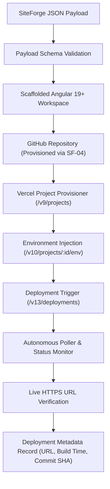

# SiteForge Vercel Deployment Pipeline Architecture (SF-05)

## Overview

The `@siteforge/vercel-pipeline` module provides autonomous, zero-config deployment orchestration for Angular 19+ standalone applications scaffolded by SiteForge. It bridges provisioned GitHub repositories and generated Angular codebases to live, global HTTPS production infrastructure on Vercel.



---

## 1. Angular 19+ Zero-Config Deployment Configuration

SiteForge scaffolds standalone zoneless Angular 19+ applications using the modern `@angular/build:application` compiler. The deployment pipeline applies the golden Vercel configuration standard:

### Framework & Preset Directives
* **Framework Preset**: `"angular"`
* **Build Command**: `npm run build` (invokes `ng build`)
* **Output Directory**: `dist/<projectName>/browser`
* **Clean URLs**: `true` (enables canonical routes without trailing `.html`)
* **SPA Routing Fallback**:
  ```json
  {
    "routes": [
      { "handle": "filesystem" },
      { "src": "/(.*)", "dest": "/index.html" }
    ]
  }
  ```

### Generated `vercel.json` Specification
```json
{
  "$schema": "https://openapi.vercel.sh/vercel.json",
  "framework": "angular",
  "buildCommand": "npm run build",
  "outputDirectory": "dist/<projectName>/browser",
  "cleanUrls": true,
  "routes": [
    {
      "handle": "filesystem"
    },
    {
      "src": "/(.*)",
      "dest": "/index.html"
    }
  ]
}
```

---

## 2. GitHub & Vercel Project Linking

The deployment pipeline connects to the Vercel REST API (`/v9/projects` and `/v9/projects/:id/link`) with multi-vector credential resolution:

1. **Authentication Token**:
   * Scans `options.tokenOverride` &rarr; `process.env.VERCEL_TOKEN` &rarr; `~/.local/share/com.vercel.cli/auth.json`.
   * Supports both fine-grained automation tokens (`vcp_...`) and personal access tokens.
2. **Team / Scope ID**:
   * Scans `options.teamIdOverride` &rarr; `process.env.VERCEL_ORG_ID` &rarr; active workspace team (`team_IidkeraM4yeYily0EDbOeWSD`).
3. **Repository Linking**:
   * Connects the provisioned GitHub repo (`type: "github", repo: "<owner>/<repoName>"`) to enable continuous deployment on `main`.

---

## 3. Environment Variable Injection

The `EnvManager` automatically sanitizes, scopes, and injects runtime and build environment variables:

| Variable | Scope | Type | Purpose |
|---|---|---|---|
| `SITEFORGE_PROJECT_NAME` | `production`, `preview`, `development` | `plain` | Unique identifier for deployed site |
| `SITEFORGE_SITE_TYPE` | `production`, `preview`, `development` | `plain` | Archetype classification (`learning_platform`, etc.) |
| `SITEFORGE_DESIGN_PRESET` | `production`, `preview`, `development` | `plain` | Design.md aesthetic preset (`warm-organic`, etc.) |
| `SITEFORGE_COMMIT_SHA` | `production`, `preview`, `development` | `plain` | Git commit SHA of the current release |
| `SITEFORGE_DEPLOYED_AT` | `production`, `preview`, `development` | `plain` | ISO 8601 deployment timestamp |
| `NEXT_PUBLIC_*` / `NG_APP_*` | All targets | `plain` | Client-accessible configuration variables |
| `*_KEY` / `*_SECRET` / `*_TOKEN` | All targets | `secret` | Serverless sensitive credentials |

---

## 4. Polling, Verification & Live URL Resolution

The `DeploymentPoller` and `MetadataCollector` monitor builds and verify live availability:

1. **State Machine Transitions**:
   * `QUEUED` &rarr; `BUILDING` &rarr; `READY` (Terminal Success)
   * `ERROR` / `CANCELED` (Terminal Failure with diagnostic log inspection)
2. **Exponential / Interval Polling**:
   * Default polling interval: 2,000ms.
   * Default timeout threshold: 180,000ms (3 minutes).
3. **Live HTTPS Verification**:
   * Performs an automated HTTP GET check against the deployed URL with exponential retry to confirm 2xx HTTP response and routing availability.
4. **Canonical URL Hierarchy**:
   * Primary: Production alias (e.g. `https://<projectName>.vercel.app`).
   * Secondary: Assigned custom deployment alias.
   * Fallback: Unique deployment host (`https://<deployment-host>.vercel.app`).

---

## 5. Deployment Metadata Output Schema

Every completed deployment returns a structured record conforming to the acceptance criteria:

```typescript
export interface VercelDeploymentMetadata {
  projectId: string;               // Vercel Project UID (prj_...)
  projectName: string;             // Project slug
  deploymentId: string;            // Deployment UID (dpl_...)
  liveUrl: string;                 // Live production HTTPS URL
  canonicalUrl: string;            // Immutable deployment URL
  target: 'production' | 'preview';
  readyState: VercelDeploymentState;// READY
  commitSha?: string;              // Deployed Git commit SHA
  buildDurationMs?: number;        // Total compilation & deploy time in ms
  buildDurationFormatted: string;  // Formatted duration (e.g. "18.4s")
  framework: string;               // "angular"
  inspectUrl: string;              // Vercel Dashboard inspection URL
  siteType: string;                // Archetype name
  designPreset: string;            // Design.md preset name
  createdAt: string;               // ISO 8601 creation timestamp
  readyAt: string;                 // ISO 8601 completion timestamp
}
```

---

## 6. CLI Usage

The executable `siteforge-vercel-deploy` enables manual and scripted zero-config deployment:

```bash
# Dry run validation
siteforge-vercel-deploy --payload ./samples/plantcare-academy.payload.json --dry-run

# Production deployment
siteforge-vercel-deploy --payload ./samples/plantcare-academy.payload.json --target production

# Deployed with explicit commit SHA
siteforge-vercel-deploy --payload ./payload.json --sha 3a4b5c6d
```
