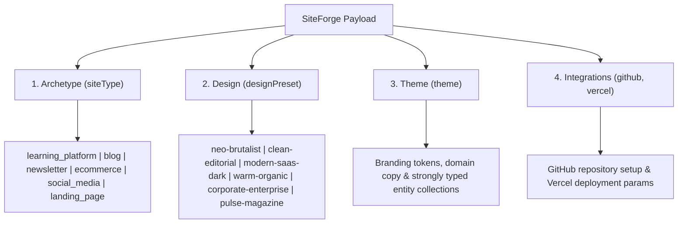

# @siteforge/payload-schema

> Canonical JSON Schema, Zod validators, and TypeScript contracts for **SiteForge** (The Autonomous Angular Web Factory).

This package formalizes the input contract governing the conversion of declarative JSON specifications into fully published, production-grade Angular web applications deployed on Vercel.

---

## Architecture Overview

Every SiteForge web application is orchestrated from 3 core pillars plus deployment integrations:



---

## 1. Core Pillars & Allowed Enums

### 1.1 `siteType` (Application Archetype)
- `learning_platform`: Courses, lessons, modules, instructors, reviews, curriculum preview (*Flagship: PlantCare Academy*).
- `blog`: Multi-author publication, reading times, tags, markdown content, newsletter CTA.
- `newsletter`: Cadence, subscriber count, edition archives, perks, sample issues.
- `ecommerce`: Currencies, product catalog, inventory status, compare-at prices, shipping highlights.
- `social_media`: Community feed, verified authors, channels, trending topics, engagement counts.
- `landing_page`: Hero section with CTAs, feature grids, pricing tiers, FAQs, social proof.

### 1.2 `designPreset` (Design Tokens mapped to `Design.md`)
- `neo-brutalist`: Signal Block — hard ink borders, electric yellow, teal secondary.
- `clean-editorial`: Gallery Press — cool paper, deep ink, vermillion print.
- `modern-saas-dark`: Forge Night — graphite, ember, brass (portal shell).
- `warm-organic`: Greenhouse Lab — limestone + chlorophyll (*PlantCare flagship*).
- `corporate-enterprise`: Ledger — white, teal authority, brass accent.
- `pulse-magazine`: Pulse Wire — near-black newsroom, chartreuse + hot amber (Pulse Feed samples).

### 1.3 `theme` (Domain Entities & Brand Identity)
- `topic`: Core subject matter (2–120 chars).
- `name`: Commercial website name (2–80 chars).
- `tagline`: Marketing slogan (5–150 chars).
- `description`: Hero & meta description (10–500 chars).
- `branding`: Hex primary/secondary color overrides, Google Font heading/body families, logo/favicon URLs.
- `content`: Strongly typed entity collections validated against the selected `siteType`.

### 1.4 `integrations` (GitHub & Vercel)
- `github`: `repoName` (alphanumeric, hyphens, periods, underscores), `owner`, `isPrivate`, `autoInit`, `defaultBranch`, `description`.
- `vercel`: `projectName` (lowercase alphanumeric and hyphens only), `teamId`, `framework` (default `angular`), `envVariables`.

---

## 2. Installation & Usage

### Installing
```bash
npm install @siteforge/payload-schema
```

### TypeScript / Zod Validation in Backend Pipelines
```typescript
import {
  validatePayload,
  siteForgePayloadSchema,
  type SiteForgePayload,
} from '@siteforge/payload-schema';

const rawPayload = JSON.parse(incomingJsonString);

// Type-safe validation with discriminated union narrowing
const result = validatePayload(rawPayload);

if (result.success) {
  const payload: SiteForgePayload = result.data;

  // TypeScript narrowing automatically handles archetype content
  if (payload.siteType === 'learning_platform') {
    console.log(payload.theme.content.courses[0].title);
  }
} else {
  console.error(result.error.toFormattedString());
}
```

### JSON Schema (Draft 2020-12) Validation
```typescript
import { validateJsonSchema } from '@siteforge/payload-schema';

const result = validateJsonSchema(rawPayload);
if (!result.success) {
  for (const issue of result.errors) {
    console.error(`Error at ${issue.path}: ${issue.message}`);
  }
}
```

---

## 3. Published Artifacts

| File | Purpose |
|---|---|
| `schemas/site-factory-payload.schema.json` | Draft 2020-12 JSON Schema for frontend form generators and OpenAPI integration |
| `src/types/payload.ts` | Discriminated union TypeScript interfaces |
| `src/schemas/payload.zod.ts` | Zod schemas with custom refinements and regex validators |
| `src/validators/validate.ts` | High-level `validatePayload` and `validateJsonSchema` functions |
| `samples/*.payload.json` | 6 complete, production-ready payload samples for all archetypes |
| `samples/invalid/*.json` | Rejection test vectors for malformed payloads |

---

## 4. Verification & Testing

Run the test suite:
```bash
npm test
npm run build
```
All 35 automated tests covering schema validation, Zod refinements, and all 6 site archetypes pass.
